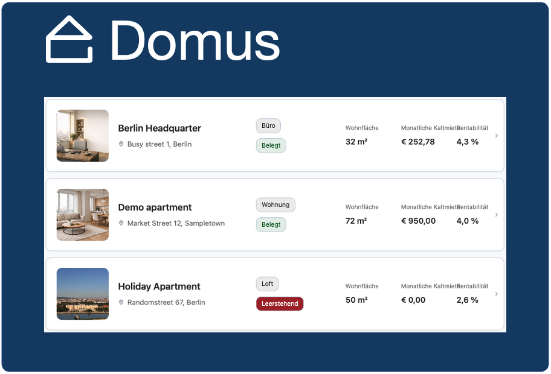
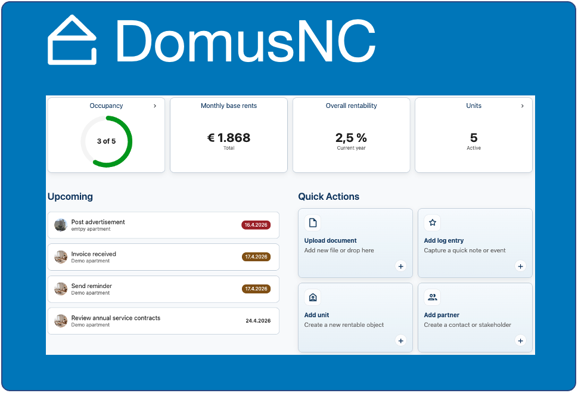
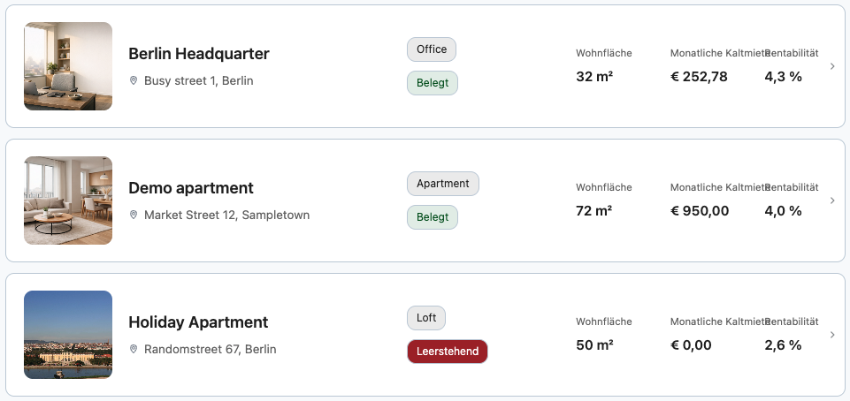
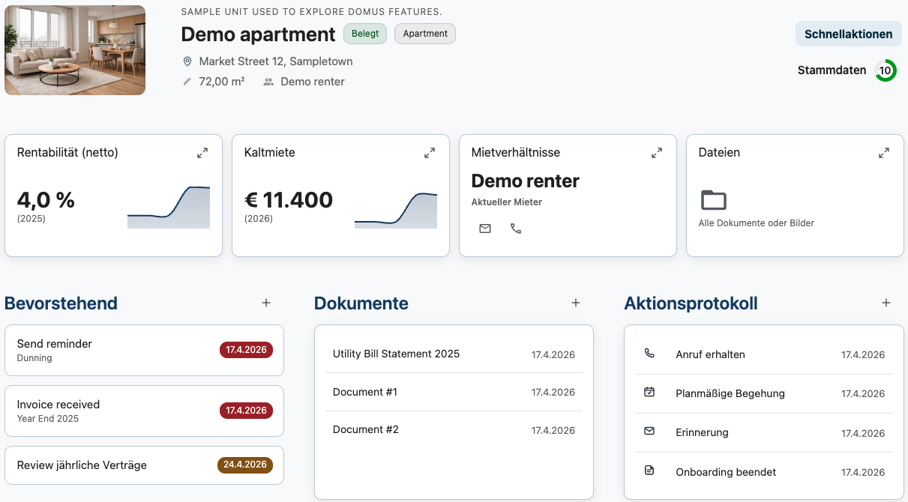
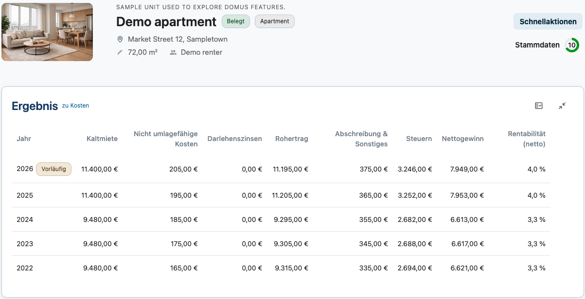

<!--
SPDX-FileCopyrightText: 2025 Marcel Scherello
SPDX-License-Identifier: AGPL-3.0-or-later
-->

[](https://github.com/rello/domus/blob/main/CHANGELOG.md)
[](http://www.gnu.org/licenses/agpl-3.0)
[](https://api.reuse.software/info/github.com/rello/domus)
[](https://github.com/sponsors/Rello)
[](https://github.com/rello/audioplayer/wiki/donate)
[](https://github.com/rello/audioplayer/wiki/donate)

# Domus

Domus bündelt die Verwaltung Ihrer Mietobjekte in Nextcloud: von Objekten und Einheiten über Mietverhältnisse und Kontakte bis zu Buchungen, Dokumenten und Aufgaben.

Ob einzelne Wohnung oder mehrere Objekte: Sie finden die zugehörigen Informationen an einem Ort und behalten anstehende Arbeiten im Blick.

## Vorschau
<p>
  <br><br>
  <br><br>
  <br><br>
  <br><br>
  
</p>

## Warum Sie es nutzen
- Verknüpfen Sie Einheiten, Mietverhältnisse, Kontakte, Buchungen und Dokumente.
- Vergleichen Sie vereinbarte Mieten mit erfassten Buchungen und sehen Sie offene Aufgaben.
- Finden Sie Dokumente und Notizen im Zusammenhang mit dem jeweiligen Objekt wieder.
- Nutzen Sie Dashboard und Auswertungen für den Überblick über Ihre Vermietungen.

Entwickelt für Vermieter und kleine Hausverwaltungen, die einen klaren Überblick im Alltag wollen und ihre Daten trotzdem privat in Nextcloud behalten möchten.

## Was Sie damit tun können
- Für jedes Objekt oder jede Einheit eine klare Übersicht führen.
- Mietverhältnisse, Kontakte und Mietzeiträume im Blick behalten.
- Einnahmen und Ausgaben als Buchungen erfassen und Dokumente zuordnen.
- Einzelne Aufgaben und mehrstufige Prozesse verfolgen.
- Buchungen nach Jahr, Einheit und Konto auswerten.

## Dokumentvorlagen für Nebenkostenabrechnungen

Unter **Einstellungen → Dokumentvorlagen** zeigt jede Zeile die Datei, den Prozess
und den Bereich mit einem Papierkorb zum Entfernen der Zuweisung. Über **+** wählen
Sie eine vorhandene DOCX-Datei aus, beispielsweise aus `DomusApp/Templates`, und
speichern die Prozesszuweisung. Die DOCX-Datei bleibt beim Entfernen erhalten.
Die Zuweisung gilt für den aktuellen persönlichen oder Team-Bereich. Team-Mitglieder
benötigen zusätzlich Zugriff auf die Datei in Nextcloud. Umbenennen und Verschieben
sind möglich, da Domus die Datei-ID speichert.

Die Vorlage enthält Layout, Absender, Unterschrift und eigene Texte. Unterstützt werden:

```text
${documentDate}          ${reportYear}
${recipientName}         ${recipientStreet}
${recipientPostalCode}   ${recipientCity}
${unitStreet}           ${prepaymentAmount}
${utilityCostAmount}    ${propertyTaxAmount}
${balanceLabel}         ${balanceAmount}
${Iban}
```

`${Iban}` stammt aus den Bankdaten der Einheit. `${balanceAmount}` ist immer positiv;
`${balanceLabel}` unterscheidet Guthaben, Nachzahlung und ausgeglichene Abrechnungen.
Vorauszahlungen werden wie bisher aus monatlichem Nebenkostenbetrag und Mietdauer
berechnet, nicht aus eingegangenen Zahlungen. Datum, Beträge und Ergebnisbezeichnung
verwenden die Sprache des erstellenden Benutzers. Wiederholte Tabellenzeilen
sind in dieser ersten Version nicht enthalten.

Für bedingte Absätze setzen Sie den Marker direkt vor den Text im selben Word-Absatz:

```text
${ifPaymentDue}Die ausstehenden Kosten bitte ich auf das Konto ${Iban} zu überweisen.
${ifCredit}Die Rückerstattung wird in den nächsten Tagen überwiesen.
```

Domus entfernt den jeweils unzutreffenden Absatz und die Marker aus dem
verbleibenden Text. Erforderliche leere Absätze für Abschnittsumbrüche und
Tabellenzellen bleiben erhalten. Bei einem auf Cent gerundeten Saldo von null entfallen beide
Absätze. Eine IBAN wird nur für tatsächlich ausgegebene Absätze benötigt.

**Nebenkostenabrechnung erstellen** erzeugt eine neue, bearbeitbare DOCX-Datei.
Prüfen Sie insbesondere den Absatz zur Zahlung oder Erstattung vor der Weitergabe.
DOCX-Entwürfe werden der Einheit und dem Kontakt zugeordnet; eine Zuordnung zum
Mietverhältnis erfolgt erst manuell, da dessen Dokumente im Mieterportal sichtbar sind.
Die Vorlage und bestehende Berichte bleiben unverändert. PDF-Export erfolgt bei Bedarf
im Office-Editor. Der Dialog zeigt die verwendete Vorlage. Vorlagen werden in den Einstellungen konfiguriert.
Ohne nutzbare Vorlage wird automatisch die bisherige Markdown-Datei erstellt;
ein Hinweis im Dialog kündigt dieses Standardverhalten an.

Der Server benötigt die PHP-Erweiterungen ZIP, XML/DOM und Intl. Vorlagen dürfen
höchstens 10 MB groß sein. Unbekannte Variablen und eine fehlende IBAN bei Verwendung
von `${Iban}` werden als Fehler gemeldet.

## Sprachen
- EN, DE

## OCS API

Die schreibgeschützte OCS API liefert Einheiten-Stammdaten und die vorhandene
jährliche Ertragstabelle für externe Anwendungen und LLM-Werkzeuge.
Siehe [OpenAPI-Spezifikation](openapi.json).

## Maintainer
- [Marcel Scherello](https://github.com/rello) (author, project leader)

## Unterstützung
Unterstützt von PhpStorm von [JetBrains](https://www.jetbrains.com/?from=AudioPlayerforNextcloudandownCloud)

<p>
  
</p>
